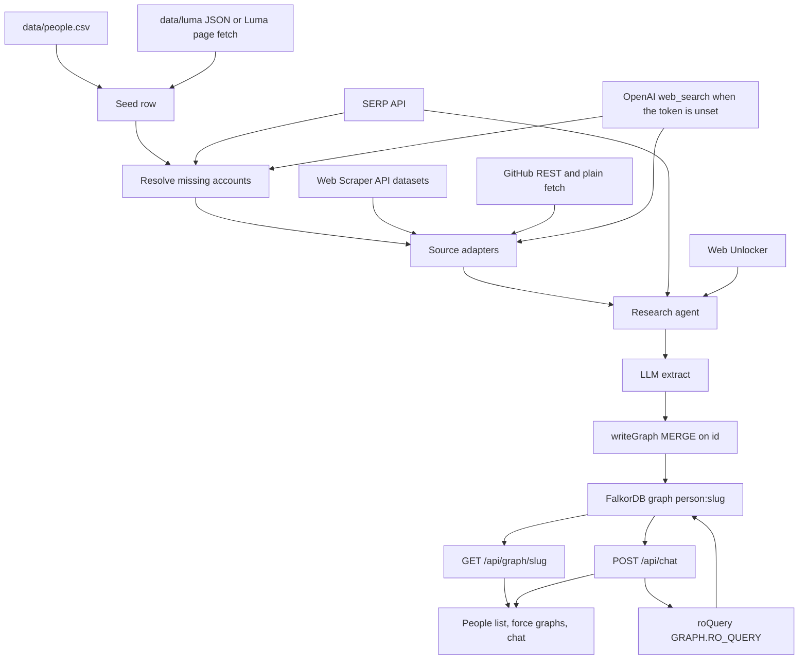

# luckdragon

A people explorer for a conference room. Each attendee gets their own FalkorDB graph, built from their public footprint. You pick someone, see their graph next to yours, and ask what you have in common. Every claim cites the nodes it came from.

You walk into a room of strangers with name tags. What they have shipped, talked about, and worked on is spread across LinkedIn, GitHub, talks, and posts. Luckdragon pulls that public footprint into one graph per person and answers questions against those graphs.

## How it works

### One FalkorDB graph per person

Graph name: `person:<slug>` (`graphName` in `lib/falkor.ts`). There is no shared room graph. Re-ingesting the same slug hits the same graph.

The root Person node id is always `person_root`. Every other id is `<type-lowercase>_<first 10 hex of sha1(type + '|' + key)>`, where `key` is the source URL when there is one, otherwise the normalized name (`lib/graph/ids.ts`).

Every node stores `id`, `label`, `source_url`, `fetched_at`, and `confidence` (0–1). Account nodes also store `matched_via`: `luma`, `search`, or `agent`.

### Schema

| Node | Properties |
|---|---|
| `Person` (exactly one, id `person_root`) | name, headline, avatar_url, location, luma_url |
| `Account` | platform, handle, url, followers, matched_via |
| `Organization` | name, kind (`company` / `school` / `community`), url, industry, size |
| `Post` | platform, text, url, posted_at, likes |
| `Video` | title, url, published_at, views, kind (`talk` / `podcast` / `video`) |
| `Repo` | name, url, description, stars, language, pushed_at |
| `Package` | registry, name, url, downloads |
| `Article` | title, url, published_at, outlet |
| `Topic` | name (free text from the model) |
| `Skill` | name |
| `Location` | name |

| Edge | From → To | Properties |
|---|---|---|
| `HAS_ACCOUNT` | Person → Account | |
| `WORKS_AT` / `WORKED_AT` | Person → Organization | title, start, end |
| `STUDIED_AT` | Person → Organization | degree, start, end |
| `AUTHORED` | Person → Post, Video, Repo, Package, or Article | at |
| `POSTED_ON` | Post or Video → Account | |
| `ABOUT` | Post, Video, Repo, or Article → Topic | |
| `USES` | Repo → Skill | |
| `HAS_SKILL` | Person → Skill | |
| `INTERESTED_IN` | Person → Topic | weight |
| `BASED_IN` | Person → Location | |

Writes go through `writeGraph` in `lib/graph/write.ts`: batched `MERGE` on `id`, 80 rows at a time. Running ingest again is safe.

### Ingest

`lib/ingest/pipeline.ts`, started by `npm run ingest` or `POST /api/ingest/[slug]`.

1. **Seed.** A row from `data/people.csv`.
2. **Luma.** A saved profile in `data/luma/<slug>.json` fills empty socials. The Luma adapter uses that file. With no saved file, it `fetch`es the Luma URL.
3. **Resolve.** Missing platforms are searched, then the model picks a URL and a confidence. Anything under 0.5 is dropped. With `BRIGHTDATA_API_TOKEN`: Google SERP (`"<name>" <hint> site:<platform>`), LinkedIn people search, and X discover-by-username. Without the token: OpenAI `web_search`, then the same pick.
4. **Fetch.** One adapter per source, up to 8 at a time. Each returns raw items. Responses are cached in `data/raw/<slug>/<source>.json`. A later run reads the cache until you pass `--fresh` (CLI) or `?fresh=1` (API). Items are limited to about the last 12 months and 20 per source.
5. **Research agent.** OpenAI Agents SDK. It looks for talks, articles, podcasts, and projects the adapters did not already return, then stops (at most 5 tool calls). With a Bright Data token the tools are `search_web` (SERP API) and `read_page` (Web Unlocker). Without a token it uses OpenAI `web_search`. Up to 12 items come back.
6. **Extract.** One structured-output call per source batch (zod schema) produces nodes and edges, including topics. If that call fails, a mechanical fallback builds nodes from the raw items.
7. **Write.** `writeGraph` MERGEs the batch into `person:<slug>`.
8. **Progress.** Each step emits an `IngestEvent`. `POST /api/ingest/[slug]` streams them as `text/event-stream`. The last line is `{"slug":"…","source":"all","status":"done"}`.

`POST /api/people` with `{ "luma_url": "https://luma.com/…" }` fetches the Luma page and appends a row to `data/people.csv`. It does not run ingest by itself.

### Chat

`POST /api/chat` with `{ viewer, person, messages, mode? }` streams `text/event-stream` events:

- `{type:"text", delta}`
- `{type:"tool", id, name, input, cypher?, rowCount?, ms?}`
- `{type:"suggestions", items}`
- `{type:"done"}`
- `{type:"error", message}`

Both graphs are serialized into the prompt (nodes as `id | type | label | key props | date`, edges as `src -TYPE-> dst`), capped at 400 nodes. The agent may call tools only for the viewer slug or the selected person:

- `run_cypher` — one read-only query via `roQuery`
- `get_node` — full properties and `source_url`
- `graph_summary` — counts by type, latest dated items, top topics

`mode: "brief"` with an empty `messages` array writes the automatic Brief (Who, Lately, Common ground, Openers) from the two graphs already in the prompt. Tools are off for that call. Follow-up questions can run Cypher.

Citations inside the answer look like `[[ada-lovelace:post_3f2a]]` (`[[<slug>:<nodeId>]]`). The UI turns them into chips. Hovering a chip highlights that node in that person's graph. A collapsed **How I know this** section under the answer shows the Cypher each tool ran, plus row count and time. The Brief has no tool calls, so that section appears on follow-ups.

Every OpenAI call (chat, Brief, extraction, resolve, research) reads `process.env.OPENAI_MODEL` through `lib/models.ts`.

### UI

Three panes. Left: searchable people list with a status of `none`, `ingesting`, or `ready`, plus node count and sources. Middle: a force graph colored by node type. When you and the other person differ, the two graphs sit side by side and cited nodes light up in both. Hovering a node shows label, type, date, source link, confidence, and `matched_via`. Right: streaming chat, citation chips, follow-up chips, and How I know this. Header: viewer picker ("I am …") and a System / Light / Dark theme toggle. "+ Add person" takes a Luma URL.

## Why FalkorDB

- One graph per attendee, named `person:<slug>`. The agent passes a slug. It does not put the graph name in the Cypher.
- Ingest writes with `graph.query` (`MERGE` on `id`). The chat agent reads with `graph.roQuery`, which is FalkorDB `GRAPH.RO_QUERY`.
- `assertReadOnly` in `lib/falkor.ts` rejects `CREATE`, `MERGE`, `SET`, `DELETE`, `REMOVE`, `DROP`, `FOREACH`, and `LOAD CSV`, and any `CALL` outside a short read-only procedure list (`db.labels`, `db.propertyKeys`, fulltext and vector query procedures, and a few others). Comments and string literals are blanked first, so a write cannot hide inside one.
- Queries time out after 8 seconds and return at most 200 rows.
- The Cypher that ran is shown to the user under How I know this, next to the node citations.
- `npx tsx scripts/test-guard.ts` checks that guard without a database.

## Why Bright Data

Three products, all in `lib/ingest/brightdata/client.ts`:

- **Web Scraper API.** `POST https://api.brightdata.com/datasets/v3/scrape` (sync, `format=json`). A `202` with `snapshot_id` is polled on `/datasets/v3/progress/{id}` and downloaded from `/datasets/v3/snapshot/{id}`.
- **SERP API.** `POST /request` with `BRIGHTDATA_SERP_ZONE`. The URL is a Google search. The client asks for parsed JSON (`brd_json=1`) first.
- **Web Unlocker.** `POST /request` with `BRIGHTDATA_UNLOCKER_ZONE`, `format=raw`, `data_format=markdown`. The research agent's `read_page` tool uses it. Luma pages and personal sites use a plain `fetch`, or a saved file under `data/luma/`.

Dataset ids live in `lib/ingest/brightdata/datasets.ts`.

| Scraper | dataset id | Called from |
|---|---|---|
| LinkedIn people profiles | `gd_l1viktl72bvl7bjuj0` | ingest (collect by URL). Experience and education come off this record. |
| LinkedIn people search | `gd_m8d03he47z8nwb5xc` | resolve |
| LinkedIn posts | `gd_lyy3tktm25m4avu764` | ingest (discover by profile URL, last 12 months, up to 20) |
| LinkedIn companies | `gd_l1vikfnt1wgvvqz95w` | `npm run smoke:bd` only |
| X profiles | `gd_lwxmeb2u1cniijd7t4` | ingest (collect by URL); resolve (discover by username) |
| X posts | `gd_lwxkxvnf1cynvib9co` | ingest (discover by profile URL) |
| YouTube channels | `gd_lk538t2k2p1k3oos71` | ingest |
| YouTube videos | `gd_lk56epmy2i5g7lzu0k` | ingest (by channel URL, or keyword `"<name> talk"` when there is no channel) |
| GitHub repositories | `gd_lyrexgxc24b3d4imjt` | ingest (discover by search URL), in addition to the GitHub REST API |
| Instagram profiles / posts | `gd_l1vikfch901nx3by4` / `gd_lk5ns7kz21pck8jpis` | ingest |
| Threads profiles / posts | `gd_mde7jg3ld2h3hnnf2` / `gd_md75myxy14rihbjksa` | ingest |
| Bluesky posts | `gd_m6hn4r5s27zfhc7w4` | ingest (discover by profile URL) |
| Reddit profiles / posts | `gd_mgnh0p8w16o65lmhp` / `gd_lvz8ah06191smkebj4` | ingest |
| Crunchbase companies | `gd_l1vijqt9jfj7olije` | ingest, when a Crunchbase URL was resolved |
| npm / PyPI | `gd_mk57m0301khq4jmsul` / `gd_mk57kc3t1wwgmnepp9` | ingest, when an npm or PyPI URL was resolved |

### When something fails

- A source error is an event. The other sources still run, and the graph is written from whatever came back.
- Post scrapes that throw are dropped. The profile items are kept.
- One SERP failure during resolve skips that platform and continues.
- With no `BRIGHTDATA_API_TOKEN`, resolve and the LinkedIn, X, YouTube, Instagram, Threads, Bluesky, Reddit, Crunchbase, npm/PyPI, and SERP adapters use OpenAI `web_search`. Those calls share a cap of 6 per person. A source past the cap is skipped with "cap reached". The research agent's own `web_search` turns are separate from that cap.
- GitHub always uses the REST API (`GITHUB_TOKEN`, or `gh auth token` when that env var is empty). The GitHub dataset runs only when the Bright Data token is set.
- The research agent uses OpenAI `web_search` when the token is missing.
- If structured extraction throws, nodes are built directly from the raw items.
- SERP and Unlocker retry once on a 5xx or a network error.
- Raw JSON under `data/raw/` is reused until `--fresh` or `?fresh=1`.
- `npm run smoke:bd` prints the request it would send when the token is missing. With the token set, it calls Unlocker, SERP, and one scrape per dataset.

## Architecture



## Run it locally

Docker, Node, and npm. FalkorDB listens on port 6379. Its own browser UI is on port 3001. This app is on port 3000.

```bash
docker compose up -d
cp .env.example .env.local
npm install
npx tsx scripts/seed-fixtures.ts
npm run dev
```

`scripts/seed-fixtures.ts` writes two fixture graphs, `person:demo-viewer` and `person:demo-alex`, with no web calls. The Person nodes in those graphs are Maya Ellison and Alex Rivera. When `data/people.csv` is missing, the people list shows those slugs as Demo Viewer and Demo Alex. Open http://localhost:3000, choose Demo Viewer with "I am …", and open Demo Alex.

### Environment

Copy `.env.example` to `.env.local`. Names only:

| Variable | Read by |
|---|---|
| `OPENAI_API_KEY` | the OpenAI SDK |
| `OPENAI_MODEL` | `lib/models.ts` (chat, Brief, extraction, resolve, research) |
| `FALKORDB_URL` | `lib/falkor.ts`. Default `falkor://localhost:6379` |
| `FALKORDB_CLOUD_URL` | present in `.env.example`. The client does not read it. Point `FALKORDB_URL` at the instance you want. |
| `BRIGHTDATA_API_TOKEN` | scrapers, SERP, and Unlocker. Empty means the fallbacks above. |
| `BRIGHTDATA_UNLOCKER_ZONE` | Web Unlocker zone name |
| `BRIGHTDATA_SERP_ZONE` | SERP zone name |
| `GITHUB_TOKEN` | GitHub REST. Empty falls through to `gh auth token`. |

### Your own people list

`data/people.csv` is gitignored, and so are `data/luma/` and `data/raw/`. If the CSV is missing, the app lists the two fixture slugs. To ingest real people, create the file with this header:

```text
slug,name,role,luma_url,headline,avatar_url,linkedin,x,github,youtube,instagram,tiktok,website,other_links
```

```bash
npm run ingest -- <slug>
npm run ingest -- --all
npm run ingest -- <slug> --fresh
```

`--concurrency` defaults to 3 when you pass `--all`. Ingest prints each event as JSON and needs `OPENAI_MODEL`.

### Checks

```bash
npm run smoke:bd
npx tsx scripts/test-guard.ts
```

## API

| Route | Does |
|---|---|
| `GET /api/people` | `{ people: PersonRow & { status: "none" \| "ingesting" \| "ready", nodeCount, sources } }` |
| `POST /api/people` | body `{ luma_url }` → `{ person }` |
| `POST /api/ingest/[slug]` | SSE ingest events. Optional `?fresh=1`. |
| `GET /api/graph/[slug]` | `{ root, nodes, links }`. `links` use node ids as `source` and `target`. |
| `POST /api/chat` | SSE chat events. `mode: "brief"` with empty messages writes the Brief. |

## Repo map

```text
PLAN.md                         spec
docker-compose.yml              FalkorDB on :6379, browser UI on :3001
.env.example
package.json                    dev, ingest, smoke:bd, typecheck
app/page.tsx                    three-pane shell
app/tokens.css                  theme tokens and graph colors
app/api/people/route.ts
app/api/ingest/[slug]/route.ts
app/api/graph/[slug]/route.ts
app/api/chat/route.ts
components/shell/               people list, force graph, chat
lib/types.ts                    GraphNode, GraphEdge, PersonRow, IngestEvent
lib/falkor.ts                   client, graph names, GRAPH.RO_QUERY guard
lib/models.ts                   OPENAI_MODEL
lib/people.ts                   data/people.csv
lib/graph/ids.ts                node ids
lib/graph/write.ts              writeGraph
lib/graph/read.ts               getGraph
lib/graph/serialize.ts          prompt text for the agent
lib/agent/chat.ts               streamChat
lib/agent/tools.ts              run_cypher, get_node, graph_summary
lib/agent/prompt.ts             Brief instructions and schema
lib/ingest/pipeline.ts          the pipeline
lib/ingest/resolve.ts           identity resolution
lib/ingest/extract.ts           structured extraction
lib/ingest/research-agent.ts    talks, articles, projects
lib/ingest/brightdata/client.ts SERP, Unlocker, scrape
lib/ingest/brightdata/datasets.ts
lib/ingest/sources/             luma, linkedin, x, youtube, github,
                                instagram, threads, bluesky, reddit,
                                crunchbase, packages, website, serp
scripts/ingest.ts
scripts/seed-fixtures.ts
scripts/smoke-brightdata.ts
scripts/test-guard.ts
data/people.csv                 gitignored
data/luma/                      gitignored saved Luma profiles
data/raw/<slug>/                gitignored fetch cache
```
